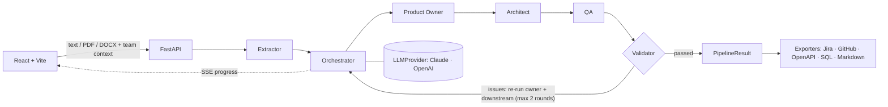

# Specforge

**Turn a software idea or a requirements document into user stories, a data model, a REST API and test cases, checked for consistency and ready for Jira, GitHub, OpenAPI and PostgreSQL.**

<!-- Record after deploy: docs/demo.gif -->


**Try it live:** _link coming soon_. No signup: pick an example and watch the agents work.

---

## What it does

You paste an idea or upload a PDF/DOCX. A pipeline of agents breaks it down:

| Step | Output |
|---|---|
| **Product Owner** | User stories with priority and Gherkin acceptance criteria |
| **Architect** | Relational data model and REST endpoints, each linked to the stories it serves |
| **QA** | Test cases (happy path, edge cases, errors) for every endpoint |
| **Validator** | Deterministic checks; any mistake goes back to the agent that made it |

Then you can **refine** any section with plain feedback ("split login into two stories") and **export**:

- **Jira CSV**: one story per row, ready for Jira's importer
- **GitHub Issues**: one issue per story, created in your repo
- **OpenAPI 3.1**: paths, parameters and schemas derived from the data model
- **PostgreSQL DDL**: `CREATE TABLE` script ordered by foreign keys (cycles handled)
- **Markdown**: one document, with an ER diagram that renders on GitHub
- **JSON**: re-import it later to keep refining

The UI is in English; generated content is in Spanish.

## Architecture



```
backend/app/
  schemas.py        Pydantic contracts shared by every unit
  providers/        LLMProvider protocol + Claude, OpenAI and Fake adapters
  agents/           one class + one prompt file per agent
  validator.py      9 deterministic consistency checks
  orchestrator.py   pipeline, correction loop, refinement (async generator of events)
  exporters/        pure functions: PipelineResult -> file
  main.py           HTTP + SSE, quota, size limits
frontend/src/
  api/              typed client and a fetch-based SSE parser
  components/       input, live pipeline, result tabs, refine, export
```

## Design decisions

**Hand-written orchestration, no LangChain.** The pipeline is about 135 lines of async Python, and every step is visible in one file. There is no framework abstraction to debug. Agents depend on a one-method `LLMProvider` protocol, so adding a provider means adding one file. The orchestrator never sees which provider it is using.

**A deterministic validator instead of an LLM judge.** "Every story has an endpoint", "every endpoint has a test" and "every foreign key points to a real column" are checked in plain code. Each issue names the agent that owns it. The orchestrator re-runs only that agent and the ones downstream of it, passing the exact problems. Results are the same every time, testable, and cheap, and the self-correction loop is visible in the UI as it happens.

**Typed contracts end to end.** Each LLM call returns a Pydantic model: forced tool use on Claude, a JSON schema on OpenAI. When the output doesn't fit the schema, the agent retries once with the validation error in the prompt. Column types are a closed set, so the SQL and OpenAPI exports are a deterministic mapping, not another LLM call.

**Stateless server.** The browser keeps the result and sends it back to refine or export, and the server re-validates it every time. There is no database to run, nothing to leak, and the JSON export doubles as a save file.

**Tests that cost zero tokens.** A `FakeProvider` replays canned (and deliberately broken) outputs, so the whole pipeline, the correction loop and refinement are covered in CI without an API key.

**Cost control on a public demo.** Free runs use the owner's key and are limited per IP per day, with a global daily cap. Visitors can paste their own Claude or OpenAI key, which travels in a header for that request only. It is never stored, and a log filter masks anything that looks like a key or token.

## Use it in your team

1. Run it yourself (below) with your own `ANTHROPIC_API_KEY` or `OPENAI_API_KEY`.
2. Put your stack and conventions in **Team context** (e.g. *"PostgreSQL, NestJS, OAuth, soft delete everywhere"*). Every agent follows it.
3. Refine until it matches your project, then export to Jira or GitHub and hand the OpenAPI and SQL files to your developers as a starting point.

## Run locally

Requirements: Python 3.12+, Node 22+.

```bash
# backend
cd backend
python -m venv .venv && source .venv/bin/activate   # Windows: .venv\Scripts\activate
pip install -e ".[dev]"
cp ../.env.example .env                              # add your key
uvicorn app.main:app --reload

# frontend (new terminal)
cd frontend
npm install
npm run dev                                          # http://localhost:5173, proxies /api to :8000
```

Tests:

```bash
cd backend && pytest && ruff check .
cd frontend && npm test && npm run lint
```

## Deploy

- **Backend (e.g. Render):** root `backend`, build `pip install .`, start command:

  ```bash
  uvicorn app.main:app --host 0.0.0.0 --port $PORT --proxy-headers --forwarded-allow-ips="*"
  ```

  `--proxy-headers` matters: without it every visitor shares the proxy's IP and the free quota runs out for everyone at once.
- **Frontend (e.g. Vercel):** root `frontend`, set `VITE_API_URL` to the backend URL, then add the frontend URL to the backend's `ALLOWED_ORIGINS`.

## Configuration

| Variable | Default | Purpose |
|---|---|---|
| `ANTHROPIC_API_KEY` | – | Owner key for free demo runs on Claude |
| `OPENAI_API_KEY` | – | Owner key for free demo runs on OpenAI |
| `DEFAULT_PROVIDER` | `claude` | Provider when the request does not name one |
| `CLAUDE_MODEL` | `claude-sonnet-5-5` | Claude model id |
| `OPENAI_MODEL` | – | OpenAI model id (required to use OpenAI) |
| `FREE_RUNS_PER_DAY` | `3` | Free runs per IP per day |
| `MAX_FREE_RUNS_TOTAL_PER_DAY` | `100` | Global daily cap on free runs |
| `MAX_UPLOAD_MB` | `5` | Upload size limit |
| `MAX_TEXT_CHARS` | `30000` | Requirement text is truncated to this |
| `MAX_CONTEXT_CHARS` | `2000` | Team context is truncated to this |
| `MAX_BODY_KB` | `1024` | Body limit for refine and export requests |
| `ALLOWED_ORIGINS` | `["http://localhost:5173"]` | CORS origins (JSON list) |

## Known limits

- The free-run counter lives in memory: it resets on restart and assumes a single instance. Move it to Redis to scale out.
- Exporting to GitHub twice creates duplicate issues.
- SQL export targets PostgreSQL only.
